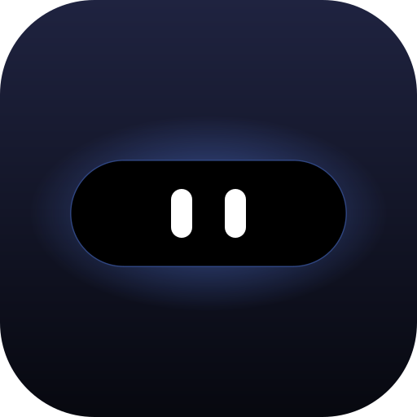
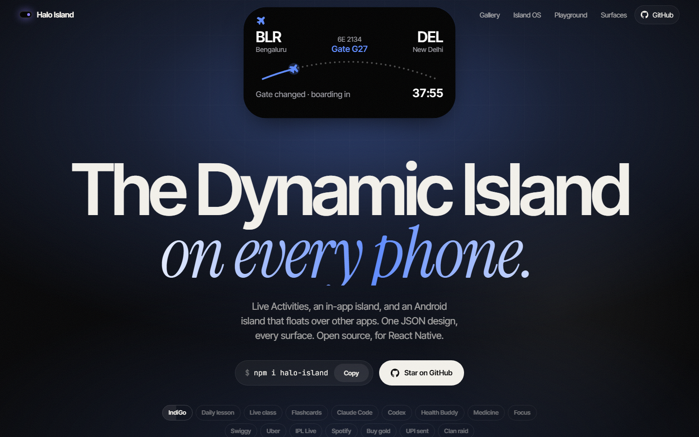
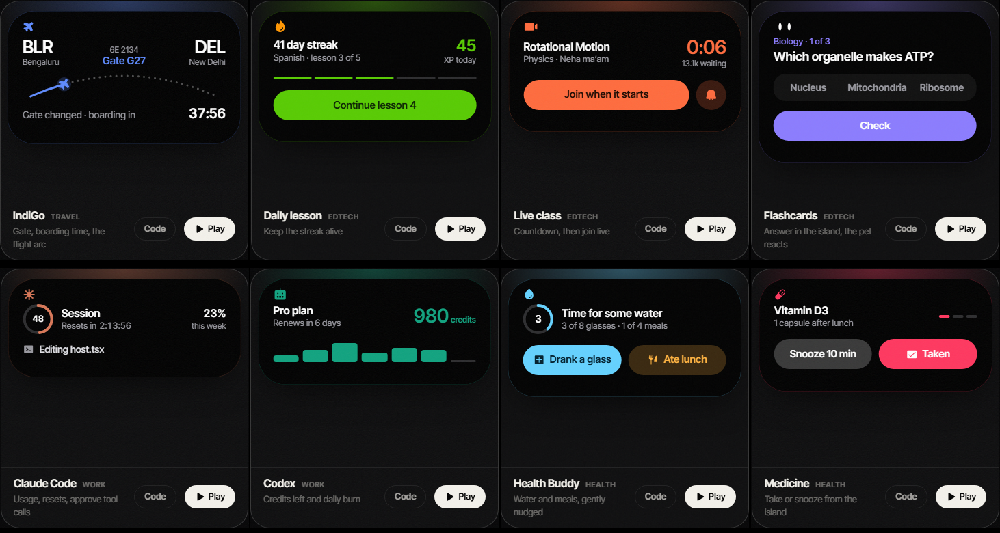
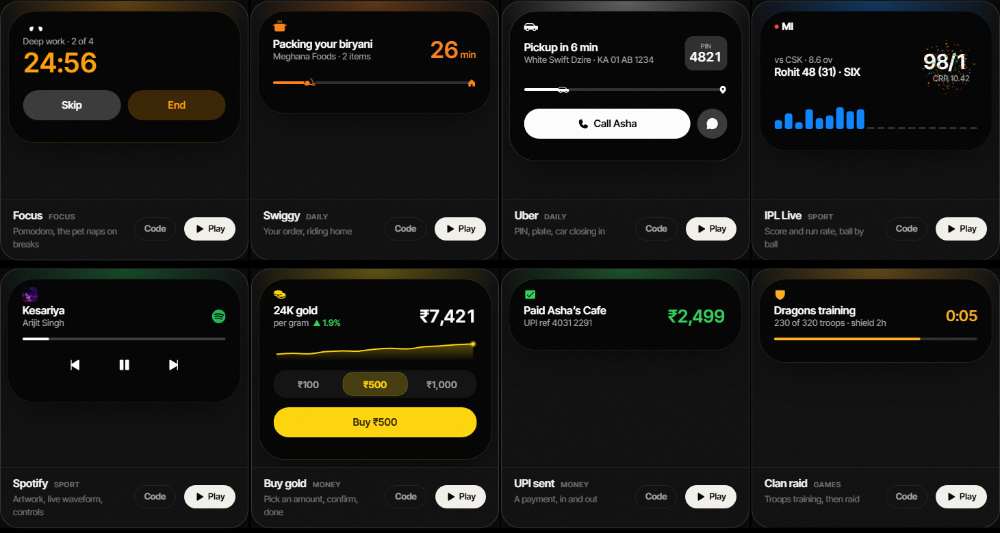
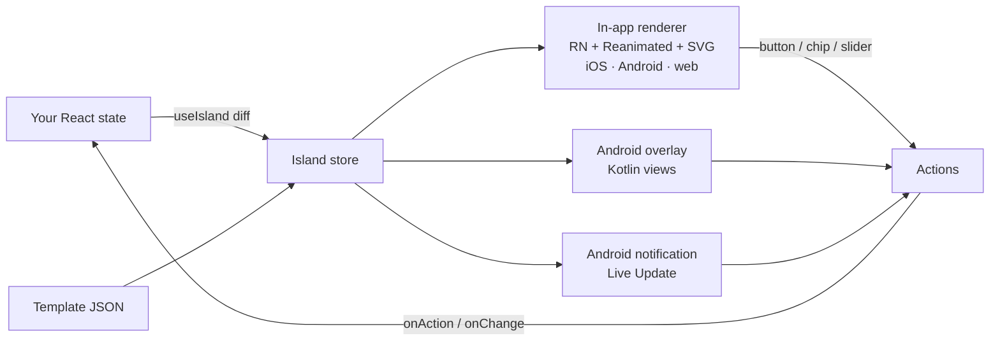

<div align="center">
  
  <h1>Halo Island</h1>
  <p><strong>A Dynamic Island for every React Native app. One JSON design, on iOS, Android and the web.</strong></p>
  <p>Flights, rides, lessons, Claude Code limits and tiny in-island apps grow out of the camera cutout, morph with spring physics and float over other apps on Android. The island is drawn from your app's own state, so it never shows something your screen doesn't.</p>
  <br/>
  <p>
    
    
    
  </p>
  <p>
    <a href="https://www.npmjs.com/package/halo-island"></a>
    <a href="https://github.com/herin7/halo-island/actions/workflows/ci.yml"></a>
    <a href="LICENSE"></a>
    <a href="https://github.com/herin7/halo-island/stargazers"></a>
  </p>
</div>

<p align="center"></p>

---

iPhones have a Dynamic Island; most phones don't, and most apps never use it well. Building one
yourself means three renderers (iOS, Android, web), spring physics that feel like the system,
background updates, and a way to keep the island from drifting out of sync with the screen it
belongs to.

**Halo Island** collapses that into one idea: **describe the island as JSON → drive it from your
state → it renders natively everywhere it can live.**

Board a flight and the island counts down to boarding, flies a plane along the route and pops open
when the gate changes. Tap **Boarding pass** on the island and your app answers. Start a Claude Code
session and the same island shows your real 5-hour limit and lets you approve a `git push` without
touching the keyboard.

## ✨ Key Features

* **🏝️ One design, every surface**: the in-app island (iOS, Android, web), the Android island over
  other apps, and the Android notification / Live Update all render the same template.
* **🔗 The island never lies**: `useIsland(template, state)` diffs against what the island shows and
  corrects drift. Inputs on the island write back to your state.
* **📱 Island apps**: screens, buttons with built-in confirm steps, chips, sliders and toggles. Whole
  flows (buy gold, book a ride, answer a quiz) run inside the island.
* **🍎 Native look**: Apple's Live Activity anatomy, SF on iOS, filled glyphs, rolling digits, flat
  capsule buttons, an optional glass material (Liquid Glass on iOS 26).
* **🐣 A character when it matters**: a pet whose eyes follow your finger and whose mood follows the
  state; Lottie and Rive for the moments worth celebrating.
* **🤖 Claude Code on your island**: a dependency-free bridge streams your real usage limits, what
  Claude is doing and its permission requests to your phone.
* **⚡ No native module needed in-app**: the in-app renderer is pure JS (react-native-svg +
  Reanimated), so it runs in Expo Go and on the web.

## 🖼️ Gallery

<p align="center"></p>
<p align="center"></p>

| Group | Island | What it shows |
|---|---|---|
| ✈️ Travel | **IndiGo** | gate, boarding countdown, a plane on the route arc, Boarding pass when boarding starts |
| 🎓 EdTech | Daily lesson · Live class · Flashcards | streak and XP · countdown to LIVE + Join · answer in the island, the pet reacts |
| 💻 Work | Claude Code · Codex | session ring, resets-in, week %, Allow/Deny · credits and daily burn |
| 💧 Health | Health Buddy · Medicine | water ring, Drank / Ate · Take or Snooze |
| ⏱️ Focus | Focus | Pomodoro; the pet naps on breaks |
| 🛵 Daily | Swiggy · Uber | order riding home · PIN, plate, car closing in |
| 💸 Money | Buy gold · UPI | amount chips, confirm, done screen · payment toast |
| 🏏 Sport | IPL · Spotify | score, per-over bars, confetti on a six · artwork, transport |
| ⚔️ Games | Clan raid | troops training, then Raid (confirm) |

Every one of these is plain data in [`example/catalog.ts`](example/catalog.ts), shared by the app
and the website. Copy the closest one.

## 🚀 Quick Start

```sh
npx expo install halo-island react-native-reanimated react-native-worklets react-native-svg
```

```tsx
import { HaloIslandHost, useIsland } from 'halo-island';
import { scenarios } from './catalog'; // or your own template

const flight = scenarios.find((s) => s.id === 'indigo')!.template;

function Trip({ trip }) {
  // The island is a view of this state: it starts, updates and ends with it.
  useIsland(flight, trip.active ? { gate: trip.gate, boardAt: trip.boardAt, progress: trip.progress } : null, {
    id: `trip-${trip.id}`,
    alertOn: ['gate'],                                   // pops open on a gate change
    onAction: (a) => a === 'pass' && showBoardingPass(),
  });
  return <TripCard trip={trip} />;
}

export default () => (<><Navigation /><HaloIslandHost /></>);
```

Full API, primitives, theming and surface limits: **[packages/halo-island/README.md](packages/halo-island/README.md)**.

## 🏛️ How It Works



**State in, actions out.** A template is JSON with `{key}` placeholders. Your app owns the state;
`useIsland` sends only the keys that changed and clears the ones you removed. Every tap, from any
surface (even with the app killed), comes back as a plain action string.

**One template, three renderers.** The in-app renderer is JavaScript, so iOS, Android and the web
look the same. On Android the same JSON is laid out natively for the over-other-apps island, and
reduced to a notification / Live Update. Anything a surface can't show (inputs, screens) is
dropped there, never faked.

## 🤖 Claude Code On Your Island

```
Claude Code ──hooks + statusline──▶ tools/island-bridge ◀──long-poll── app ──▶ island
                                         ▲                               │
                                         └──────── Allow / Deny ◀────────┘
```

Real `rate_limits.five_hour` / `seven_day` usage from Claude Code's statusline, the current task
from hooks, and `PermissionRequest` prompts you answer from the island (with a confirm step). No
answer in 90 s and Claude Code asks in the terminal as usual. Token-protected, localhost by
default. Setup: [tools/island-bridge](tools/island-bridge/README.md).

## 🛠️ Tech


An Expo module (Kotlin) for the Android overlay, notification and Live Update; a pure-JS renderer
for every in-app island; a Vite + motion website that renders the same templates in the browser.

## 💻 Running Locally

Requires [Bun](https://bun.sh), Node.js 22+, and Android Studio (or Xcode on a Mac) for the app.

<details>
<summary>Step-by-step setup</summary>

```sh
git clone https://github.com/herin7/halo-island.git
cd halo-island
bun install

cd example && bunx expo run:android      # or run:ios on a Mac
cd ../website && bun install && bun run dev

# Claude Code bridge (optional)
node tools/island-bridge/bridge.mjs
adb reverse tcp:7337 tcp:7337            # emulator or USB phone
```

The in-app island works in Expo Go; the Android overlay and Live Updates need a dev build.

</details>

## 🧪 Tests

```sh
cd packages/halo-island && bun test      # spec: placeholders, visibility, numbers, themes, presets
bunx tsc --noEmit -p example             # every template typechecks against the spec
cd website && bun run build && node scripts/cards.mjs   # renders every island to PNGs
```

CI runs all of the above on every push. Device behavior (cutout geometry, the overlay, Live
Updates) is checked on a Pixel emulator; iOS is covered by the shared JS renderer.

## 📂 Project Structure

```
halo-island/
├── packages/halo-island/   The library: spec, renderer, hooks, Kotlin module, config plugin
├── example/                Showcase app (Expo): catalog of 16 islands, Island OS, sync demo
├── website/                Docs site with a live in-browser island
└── tools/island-bridge/    Claude Code → island bridge (no dependencies)
```

## ⚠️ Honest Limits

* **iOS Live Activities (lock screen / system island) are not in 0.2.** On iOS you get the in-app
  island; ActivityKit support is next.
* The Android over-other-apps island needs the overlay permission and a `specialUse` foreground
  service, which Google Play asks you to justify.
* Live Updates need Android 16+.

## 🙏 Attribution

Glyphs: [Phosphor Icons](https://phosphoricons.com) (MIT). Lottie animations:
[confetti](https://lottiefiles.com/animations/confetti-coMR5KBYrt) by Jacques Mauriac and
[celebration checkmark](https://lottiefiles.com/animations/celebration-checkmark-mOkTobdub5) by
Jack Hawkins (Lottie Simple License). Layout follows Apple's Human Interface Guidelines for Live
Activities. Brand names in the demos belong to their owners; the demos are not affiliated with them.

[MIT](LICENSE) © Herin Soni
